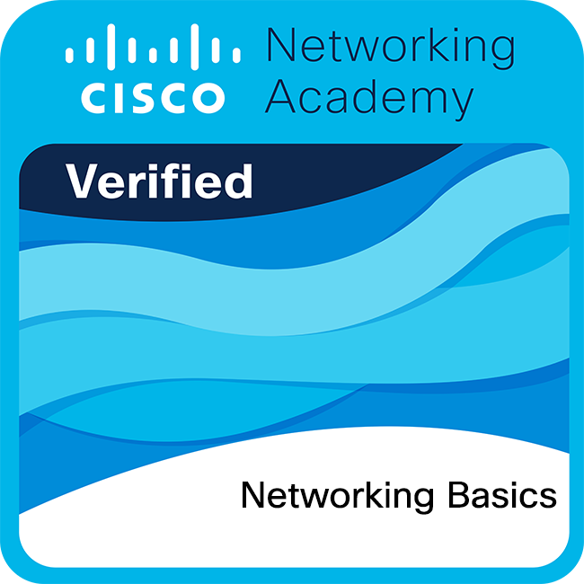

# SAÉ 1.1 · Hygiène numérique

> Initiation aux fondamentaux des réseaux, validée par le badge Cisco Networking Basics.

| | |
|---|---|
| **Formation** | BUT Réseaux et Télécommunications, Montbéliard |
| **Année** | 1re année, semestre 1 |
| **Organisation** | Travail individuel |
| **Outils et notions** | `Cisco` `Networking Basics` `Hygiène numérique` |

## Objectif

Acquérir les bases des réseaux informatiques et des bonnes pratiques numériques, puis les valider avec le parcours en ligne **Cisco Networking Basics**.

## Résultat

Badge Cisco Networking Basics obtenu en novembre 2024.

## Contenu du dépôt

| Fichier | Description |
|---|---|
| [`certificat/certificat-cisco-networking-basics.pdf`](certificat/certificat-cisco-networking-basics.pdf) | Certificat Cisco |
| [`certificat/badge-networking-basics.png`](certificat/badge-networking-basics.png) | Badge Networking Basics |

---

Bastien Lorenzi · BUT Réseaux et Télécommunications, parcours cybersécurité · [Portfolio](https://bastien-lorenzi.netlify.app/#projets) · [Profil GitHub](https://github.com/LORENZI-Bastien)
